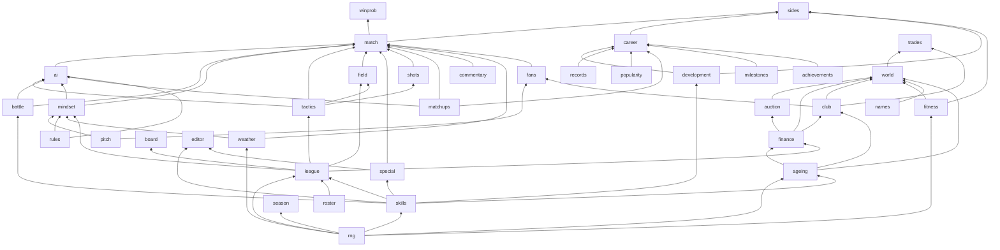

# 01: Current architecture (the JS game as it is)

Source: `t20-coach/` (v2.2.0). About 15,000 lines of source: 37 engine modules (pure JS), 8 Redux files, 50 React components, 1,500 lines of CSS, 28 test files.

## 1. The four layers

```
┌───────────────────────────────────────────────────────────────────────────┐
│  UI layer          src/components/*.jsx, App.jsx, main.jsx, styles.css     │
│                    Reads state with useSelector, sends actions with        │
│                    dispatch. Owns only throwaway view state (tabs, drafts). │
├───────────────────────────────────────────────────────────────────────────┤
│  Data access       src/hooks.js, src/data.js                               │
│                    useLeague / usePlayer / useTeamOf: the league as it is   │
│                    now = world squads + match-by-match development.        │
├───────────────────────────────────────────────────────────────────────────┤
│  State layer       src/store/*.js  (Redux Toolkit)                          │
│                    6 slices + thunks + one listener + a save subscriber.    │
│                    Reducers hand the state straight to engine functions,    │
│                    which mutate it (Immer drafts).                          │
├───────────────────────────────────────────────────────────────────────────┤
│  Engine            src/engine/*.js  (pure JS, no React, no browser APIs)   │
│                    All rules and simulation. Mutates plain objects in place │
│                    or returns new ones. Runs in reducers, Node scripts and  │
│                    tests unchanged.                                         │
└───────────────────────────────────────────────────────────────────────────┘
```

**The single most important fact for the port:** the engine never touches React or the browser. It only reads and writes plain objects. That means it ports to C++ as a library, and the UI is rebuilt on top of it.

## 2. Entry and boot

| File | Role |
|------|------|
| `index.html` | Loads the Barlow / Barlow Condensed Google Fonts, sets the background `#060b12`, mounts `#root`. |
| `src/main.jsx` | `makeStore(hotState)`, applies the `?screen=season|club|players` shortcut, registers a claude.ai hot-reload snapshot, renders `<Provider><App/></Provider>`, calls `initPwa()`. |
| `src/App.jsx` | Turns `setup.screen` into a view, draws the top `NavBar`, the setup `Stepper`, the current screen, and the always-mounted `PlayerCard` modal. Scrolls to the top on every view change. Prefetches lazy screens when idle. |
| `src/lazyScreens.js` | `React.lazy` for Season hub, Off-season, Club, Sacked, Players, Player editor. |
| `src/pwa.js`, `pwa/` | Service worker, install prompt, update toast. **Dropped in C++.** |

### View routing (App.jsx)

There is no router library. `setup.screen` is a string, and `App` maps it to a view:

| `setup.screen` | View shown | Notes |
|----------------|-----------|-------|
| `'draft'`, `'offseason'` | `OffseasonView` | `'draft'` is a legacy alias |
| `'club'` | `ClubView` | |
| `'sacked'` | `SackedView` | |
| `'season'` | `SeasonHub` | Shows `StartSeason` when there is no season |
| `'players'` | `Players` | Remembers `returnTo` |
| `'match'` | `MatchView` | Only if a match exists, else Home |
| `'toss'` | `Toss` | Only if a match exists, else Home |
| `'xi'` | `PickXI` | |
| `'training'` | `Training` | |
| anything else | `Home` | |

The `Stepper` (Teams › Playing XI › Training › Toss › Match) shows only on `xi`, `training`, `toss`.

## 3. State layer (Redux Toolkit)

`src/store/store.js` builds one store with six slices:

| Slice | File | Holds | Saved to (localStorage) |
|-------|------|-------|------------------------|
| `setup` | `setupSlice.js` | Current screen, user team, opponent, pitch, XI, keeper, captain, saved line-ups per team, training plan, the season fixture being prepared, match preferences | `t20coach.setup.v2` (partial) |
| `match` | `matchSlice.js` | The one match in progress (or `null`) | **not saved** |
| `career` | `careerSlice.js` | Career stats for every player, development, records book, popularity, match-ups, milestones, manager record | `t20coach.career.v2` |
| `ui` | `uiSlice.js` | Which player card is open, and whether in editor mode | not saved |
| `season` | `seasonSlice.js` | Current season (fixtures, results, playoffs), past seasons, `busy` progress | `t20coach.season.v2` |
| `world` | `worldSlice.js` | The living league: every player, squads, contracts, draft, auction, off-season, board/manager, clubs, transfers | `t20coach.world.v1` |

`editsSlice.js` is legacy (v0.8 edit overlay). It is not in the store; `loadEdits()` is only read once to migrate old saves into the world.

### Three mechanisms on top of the slices

1. **Thunks** (`store/thunks.js`): multi-step operations such as `startFixture`, `startSeason`, `simFixtures`, `nextSeason`, `startOffseason`, `finishOffseason`, `proposeTrade`. They read state, call engine functions and dispatch several actions. Full list in [06](06-state-actions-controller.md).
2. **The match-complete listener** (`store.js`): fires once when `match.status` becomes `'complete'`. It records the match in career stats, applies fitness and injuries, and, for a season fixture, records the result, takes the gate money and moves board confidence.
3. **The save subscriber** (`store.js`): after every action, saves any of `career`, `season`, `world`, `setup` whose object identity changed.

### Boot sequence (`makeStore`)

1. `career` ← `loadCareer()`; `season` ← `loadSeason()`; `world` ← `loadWorld()` (with `upgradeWorld`) or `migrateWorld(career)` (folds v0.8 edits + v1.0 ageing into a fresh world) or `freshWorld()`.
2. `setup` initial state is built at import time from `loadSetup()`: user team, opponent, pitch, line-ups, preferences. If no saved XI, `pickBestXI` on the generated league.
3. `ui` is always reset.
4. If the saved XI is empty or contains a player no longer in the user's world squad (retired, traded, released), dispatch `autoPick()`.

## 4. Data access (`data.js`, `hooks.js`)

- `LEAGUE = generateLeague()`: the 10 teams × 16 players exactly as generated from `roster.js`. Used as the static team list (names, colours, grounds) and the fallback before a world exists.
- `effectiveLeague(world, progress)`: the league as it is now. Takes `worldTeams(world)` (squads as player objects) and applies each player's match development `career.progress[id]` on top (`applyProgress`), sets `devBase` (the skills development is measured from) and `unavailable` (injured). Memoised on object identity.
- `allPlayersIn(world, progress)`: same, for every player the world knows, including free agents and retired players.
- Hooks: `useLeague()`, `useTeam(id)`, `usePlayerLookup()`, `usePlayer(id)`, `useTeamOf()`, `useTeamIdOf()`.

**Two layers of player skills exist at once:**

| Layer | Where | Changes when |
|-------|-------|--------------|
| Stored skills | `world.players[id].skills` | Generation, off-season ageing, coaching, editor |
| Development | `career.progress[id]` (deltas, capped ±8%) | After every match the player plays |

The player you see on screen and send into a match = stored skills + development deltas, headline ratings recomputed.

## 5. Engine modules

### By responsibility

| Group | Modules |
|-------|---------|
| Foundations | `rng.js` (mulberry32), `rules.js` (overs, quotas, phases, bowler eligibility), `pitch.js` (5 pitch types), `names.js` |
| Players and teams | `roster.js` (160 hand-written players, 10 teams), `skills.js` (sub-skills, weights, styles, generation), `league.js` (generation, best XI, batting order, bench, captain) |
| Ball model | `battle.js` (threat/control/survive/hit numbers), `mindset.js` (confidence, rhythm, awareness, wear, dew), `tactics.js` (bowling plans, weaknesses, AI captain styles), `field.js` (23 positions, presets, legality, shot resolution), `special.js` (signature deliveries), `matchups.js` (head-to-head), `shots.js` (shot direction), `weather.js` (sky, rain, DLS) |
| Match | `match.js` (the engine: setup, toss, decisions, ball, DRS, innings, Super Over, Impact Player, rain), `ai.js` (bowling changes, tempo, next batter, toss), `commentary.js`, `fans.js` (crowd, display only), `winprob.js` (Monte-Carlo win chance) |
| Between matches | `sides.js` (build a side for a match, sim an AI fixture), `career.js` (record a match), `development.js` (training drills, per-match development), `fitness.js` (workload, recovery, injuries), `records.js`, `popularity.js`, `milestones.js`, `achievements.js` |
| Season | `season.js` (fixtures, table, NRR, playoffs, stats, analytics, awards) |
| World | `world.js` (living league, off-season, draft), `ageing.js`, `finance.js` (money, contracts, valuations), `auction.js`, `board.js`, `club.js` (club business), `trades.js` (transfer room), `editor.js` |

### Dependency graph (bottom-up; port in this order)



## 6. UI layer

50 components. Grouped by screen (each group has a screen doc in `screens/`):

| Screen | Components |
|--------|-----------|
| Shell | `App.jsx` (`NavBar`), `ui.jsx` (Icon, TeamBadge, Avatar, Meter, PageHeader, Stepper, useStoredToggle, CollapsedPanel, MinimizeButton, FitnessTag), `common.jsx` (Crest, Rating, bowlShort, bowlLabel), `HeroArt.jsx` |
| Home | `Home.jsx`, `InstallBanner.jsx` |
| Playing XI | `PickXI.jsx` |
| Training | `Training.jsx` |
| Toss | `Toss.jsx`, `Milestones.jsx` (`MilestonesInSight`) |
| Match | `MatchView.jsx`, `MatchDock.jsx`, `Scoreboard.jsx` (+ `BallChip`, `useMoment`), `Crease.jsx`, `CaptainPanel.jsx` (BowlerPicker, BatterPicker, Tempo, BatterTarget, BowlingPlan, FieldControl, ReviewCall), `ImpactPanel.jsx`, `FieldView.jsx`, `Commentary.jsx`, `FansMeter.jsx`, `Scorecard.jsx`, `Worm.jsx`, `Manhattan.jsx`, `WinProb.jsx` (WinBar, WinProbChart), `DevelopmentReport.jsx`, `PopularityMeter.jsx`, `Milestones.jsx` (ChaseList, MatchMilestones) |
| Player card | `PlayerCard.jsx` (PlayerLink, PlayerAvatar), `SkillBreakdown.jsx`, `PlayerEditor.jsx` |
| Season | `season/SeasonHub.jsx` (StartSeason, NextUp, Poster, Kpis, Overview, TransferNudge), `PointsTable.jsx`, `Fixtures.jsx`, `Playoffs.jsx`, `SeasonStats.jsx`, `TeamAnalytics.jsx`, `Awards.jsx`, `TransferRoom.jsx`, `SortableTable.jsx`, `BoardPanels.jsx` (BoardPanel, InjuryList) |
| Off-season | `offseason/OffseasonView.jsx`, `ContractsStage.jsx` (PurseBar), `RetentionStage.jsx`, `Draft.jsx`, `AuctionStage.jsx`, `OffSeasonReport.jsx` |
| Club | `ClubView.jsx`, `club/ClubBusiness.jsx` (PlanBanner, AccountsPanel, SponsorsPanel, GroundPanel, YouthPanel), `SackedView.jsx` |
| Players | `Players.jsx`, `RecordsBook.jsx` (RecordsBook, HallOfFame), `Achievements.jsx` |

### Patterns the UI uses (and their C++ meaning)

| React pattern | Meaning | C++ equivalent |
|---------------|---------|----------------|
| `useSelector(s => …)` | Read a slice | Read `game.state()` directly each frame |
| `dispatch(action)` | Change state | Call a `Game` method |
| `useState` in a component | Throwaway view state (tab, draft, confirm) | A member of the screen class |
| `useStoredToggle(key)` | View preference remembered in `localStorage` (`t20coach.ui.<key>`) | `Settings` saved to `settings.json` |
| `useMemo` | Cache a derived value | Cache keyed by a state revision counter |
| `PlayerLink` | Any player name is a button that opens his card | `widgets::PlayerLink(id)` calls `game.openCard(id)` |
| Modal (`PlayerCard`) | Always mounted, shows when `ui.cardPlayerId` is set | ImGui popup modal drawn after the screen |

## 7. Supporting files

| Path | Purpose | C++ fate |
|------|---------|----------|
| `scripts/balance.mjs` | Sim N AI matches, print T20 benchmarks | Port as `tools/balance.cpp` (parity target) |
| `scripts/behaviour.mjs` | Prove awareness / wear / dew effects | Port as `tools/behaviour.cpp` |
| `scripts/fielding.mjs` | Fielding stats | Optional port |
| `scripts/build-artifact.mjs`, `artifact/` | Single-file claude.ai build | Dropped |
| `tests/*.test.js(x)` | 28 suites, ~130 tests | Port engine suites to Catch2; UI suites become manual checklists (see 10) |
| `public/icons/icon.svg` | App icon source | Convert to `app.ico` |
| `README.md`, `project-notes.md` | Feature history and rules | Keep; they explain the rules the engine implements |
