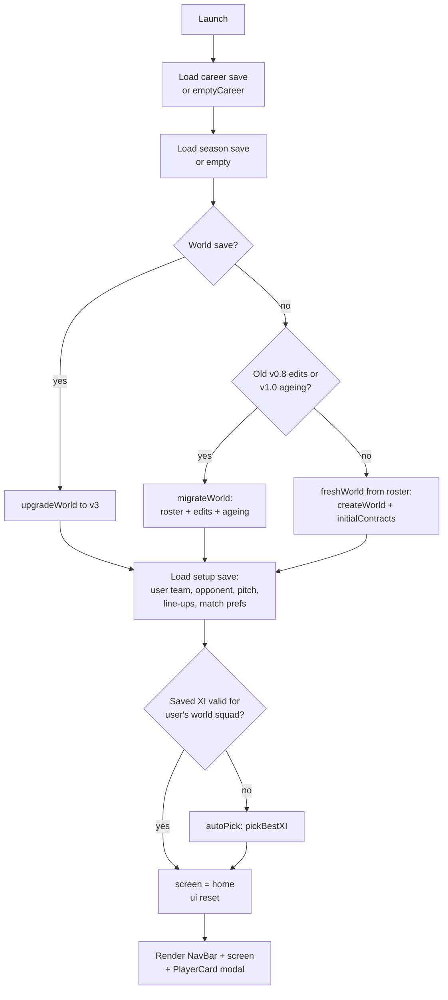
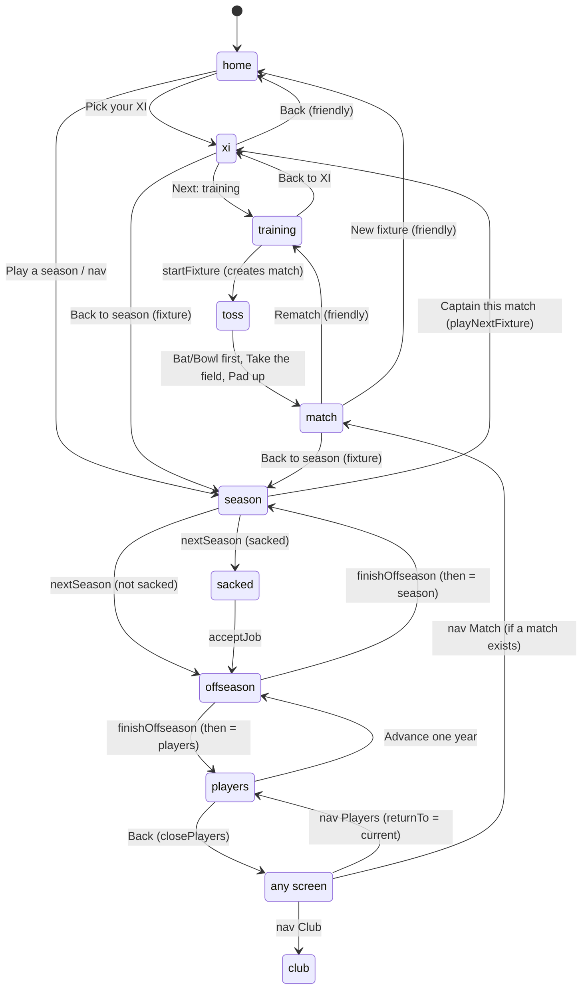
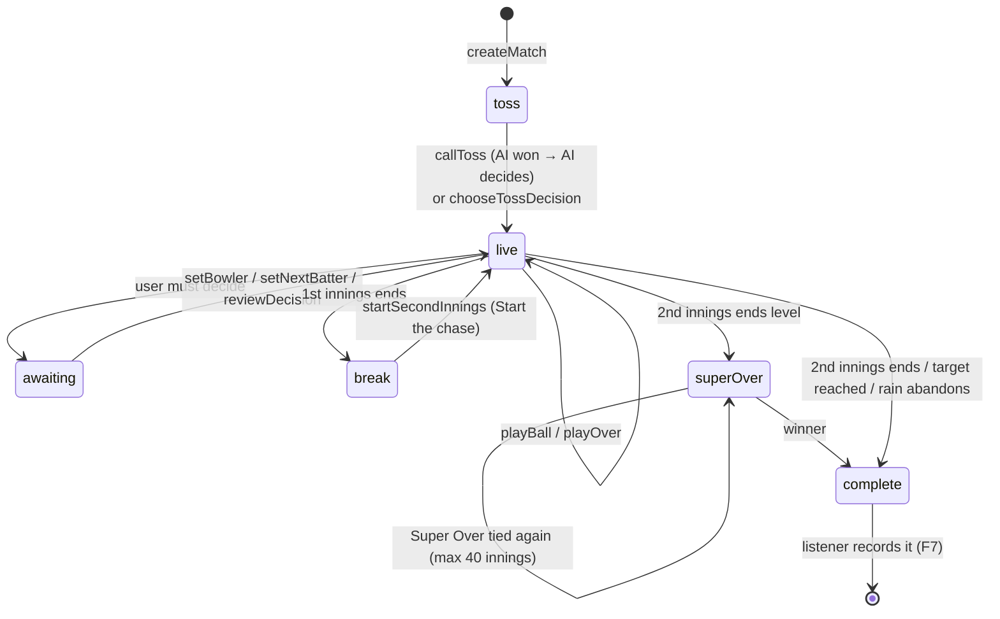
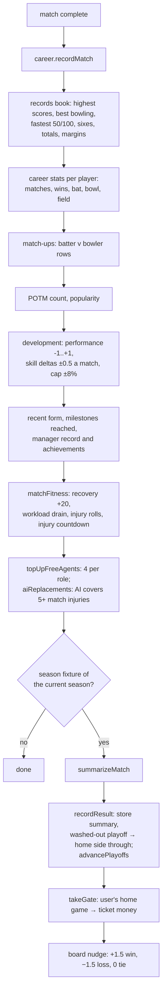
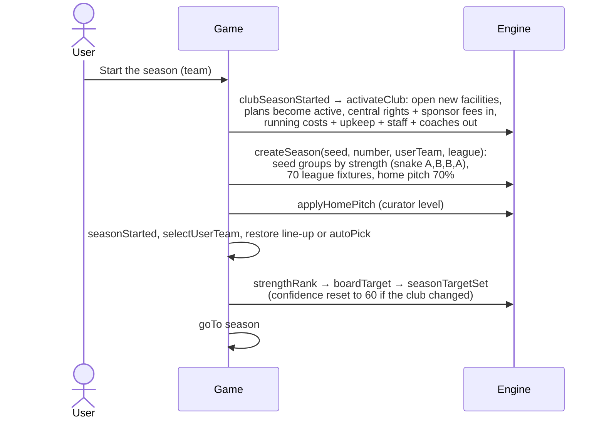
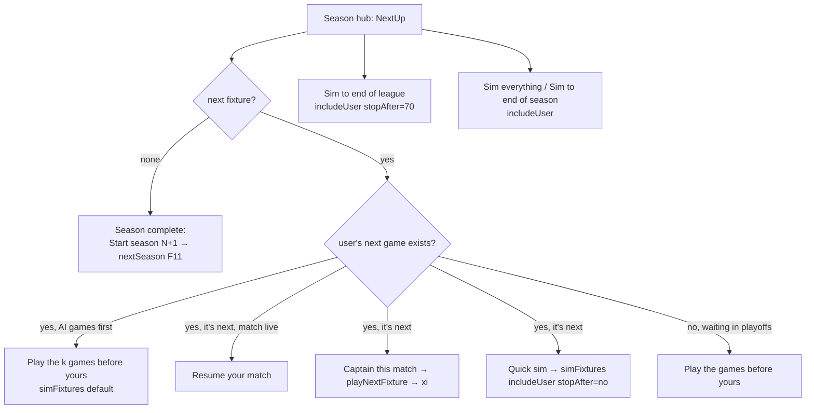
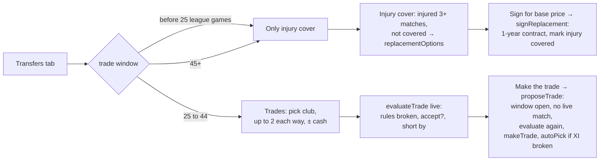
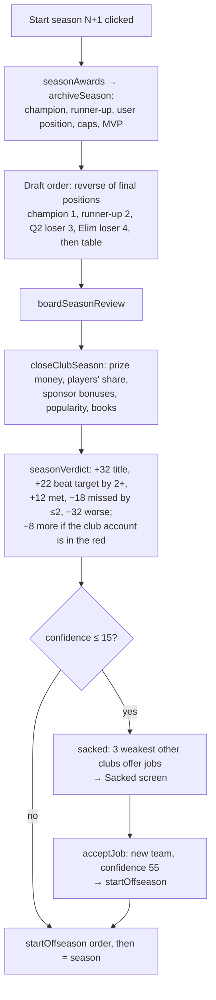
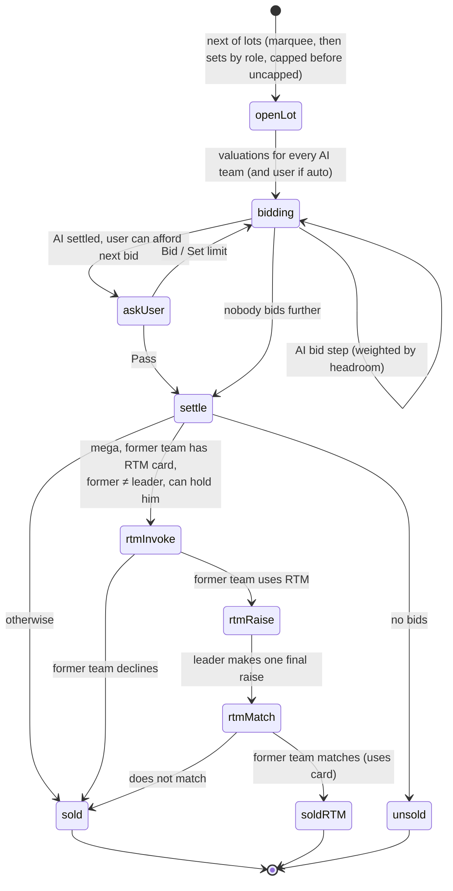
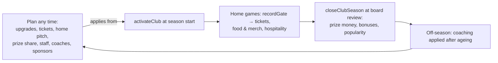

# 02: Process flows

Every flow in the game, as the JS code runs it today. The C++ version must run the same steps in the same order (order matters: several steps draw random numbers, and some steps read what the previous one wrote).

Names in `code` are the JS functions; [06](06-state-actions-controller.md) gives the C++ method for each.

---

## F1. App start



Notes:
- `setup.screen` always starts at `'home'` (not saved).
- The match in progress is **not** saved by the web build. The C++ build should save it (see [07](07-persistence.md)).

---

## F2. Screen navigation



**NavBar** (always on top):

| Link | Goes to | Highlighted when | Disabled when |
|------|---------|------------------|---------------|
| Brand "T20 Coach" | `home` | — | — |
| Home | `home` | view is `home`, `xi`, `training` | — |
| Season | `season` | view is `season`, `offseason`, `sacked` | — |
| Club | `club` | view is `club` | — |
| Match (red live dot if status ≠ complete) | `toss` if `match.status === 'toss'`, else `match` | view is `match` or `toss` | no match |
| Players | `players` (stores `returnTo`) | view is `players` | — |

When a season exists the nav also shows `Season N · 3rd · 12 pts`.

---

## F3. Friendly match

```mermaid
sequenceDiagram
  actor U as User
  participant H as Home
  participant X as Playing XI
  participant T as Training
  participant G as Game (thunks)
  participant E as Engine
  U->>H: choose franchise (chooseTeam)
  H->>G: selectUserTeam + restore saved line-up or autoPick
  U->>H: choose opponent, pitch
  U->>H: Pick your XI (clearFixture, goTo xi)
  U->>X: toggle / swap / reorder players, C and WK
  U->>X: Next: training (only if no problems)
  U->>T: up to 3 drills (setTraining) or Suggest a plan
  U->>T: Go to the toss
  T->>G: startFixture()
  G->>E: random pitch if 'random'; opponent pickBestXI + aiTrainingPlan
  G->>E: buildSide(user) and buildSide(opp): fatigue, form confidence, drills, bench, captain
  G->>E: createMatch(seed, teams, settings, ground, matchups)
  G->>G: clearTraining, goTo toss
```

`startFixture` details, in order:
1. `actualPitch` = the chosen pitch, or a random one of the 5 (uses `Math.random`, not the match seed).
2. Opponent XI = `pickBestXI(opp, actualPitch)`; opponent drills = `aiTrainingPlan(oppXI, actualPitch)`.
3. Settings carried in: `aggression` and `autoBowl` from the live match if any, else `setup.matchSettings`.
4. `seed = (Date.now() ^ random31) | 0`, `id = "${seed}-${Date.now()}"`.
5. Ground: `home = fixture?.home ?? userTeamId`; capacity from that club's stands; `big` if it is a playoff fixture.
6. `createMatch({ seed, id, pitch, userTeam: 0, teams: [user side, opp side], settings, fixture, ground, matchups: career.matchups })`.
7. `clearTraining()`, `goTo('toss')`.

After the result: **Rematch** → `goTo('training')` (same XI, train again, new match). **New fixture** → keep tempo prefs, `clearMatch`, `clearFixture`, `goTo('home')`.

---

## F4. Match lifecycle



`match.awaiting` (the game waits for the user) is one of:

| Value | When | Resolved by |
|-------|------|-------------|
| `'bowler'` | Start of an over, user is fielding, `autoBowl` off, not a Super Over | `setBowler(id)` (must be a legal option) |
| `'batter'` | A wicket fell, user is batting, `autoBat` off, not a Super Over | `setNextBatter(id)` |
| `'review'` | An umpire's call went against the user's side, a review is left, `autoReview` off | `reviewDecision(true/false)` |

`resolvePending(match)` lets the AI make whichever call is waiting (used by Sim innings / Sim match and by switching on auto-bowl or auto-review).

### Starting the match (`startMatch`)

1. `battingFirst` from the toss winner and decision.
2. If the weather has `rain.when === 'pre'`: `oversPerSide = rain.overs` (5–16), DLS note, `rainDone = true`.
3. `startInnings(0)`: new innings object, opening commentary, `prepareNext` (place batters, ask for or pick a bowler).

### Innings break (`endInnings` of innings 0)

1. `status = 'break'`; `setChaseTarget` (DLS if the first innings was cut by rain).
2. Every AI side uses its Impact Player now (`aiUseImpact`).
3. The user sees the break panel: **Start the chase / Take the field** → `startSecondInnings`, or **Sim to result** → `simMatch`.

### End of the match

- 2nd innings ends level and not abandoned → `startSuperOver` (the side that batted second bats first; 6 balls, 2 wickets; top 3 hitters, best death bowler; in a repeat, dismissed batters and the previous bowler are banned).
- Otherwise `status = 'complete'`, `result = computeResult()`, `potm = playerOfTheMatch()`.

---

## F5. One ball (`playBall`): the core pipeline

This is the heart of the game. The order of random draws (`r()`) must be preserved exactly for the same seed to give the same match.

```mermaid
flowchart TD
  S[playBall] --> G0{status live and<br/>nothing awaiting?}
  G0 -- no --> X[return null]
  G0 -- yes --> C1[context: bowler, striker, over,<br/>phase (SO = death), spin, keeper]
  C1 --> C2[cond = pitchConditions:<br/>pitch, wear, new ball, dew, sky]
  C2 --> C3[plan = user plan for this bowler<br/>or aiPlan: r draws]
  C3 --> C4[eff = readByBatter planEffect<br/>streak of same plan]
  C4 --> C5[field = user field legalized<br/>or aiField; assignFielders<br/>cached per bowler+field+side]
  C5 --> C6[fe = fieldEffect]
  C6 --> C7[wideP, nbP from accuracy, swing,<br/>phase, spin, cond.wide, rhythm, plan]
  C7 --> R1[x = r]
  R1 --> W{x < wideP?}
  W -- yes --> WD[WIDE: 1 run, 4% chance of 5;<br/>3% chance of stumping off a wide to spin]
  WD --> AB[afterBall]
  W -- no --> T1[tempo = currentTempo:<br/>instruction + mindset]
  T1 --> T2[B = batterNow, T = bowlerNow,<br/>field = fieldingNow, edge = specialistEdge]
  T2 --> T3[w = outcomeWeights<br/>× plan eff × field fe × head-to-head]
  T3 --> NB{x < wideP + nbP?}
  NB -- yes --> NBR[NO BALL: weighted run off the bat<br/>without W, +1 extra, free hit next]
  NBR --> AB
  NB -- no --> SP[special delivery?<br/>rhythm ≥ 70, gap ≥ 6, r < chance]
  SP --> O[outcome = weighted r, w]
  O --> OW{W?}
  OW -- yes --> DT[dismissal type: weighted<br/>bowler × plan × field × special;<br/>free hit → run out; 6% c&b]
  DT --> FL[fielder: catch position, ring,<br/>keeper, bowler]
  FL --> DR{dropped / stumping missed?}
  DR -- yes --> DROP[outcome 0, or 1 at 30%]
  DR --> UMP
  OW -- no --> UMP[umpire call: lbw / caught behind<br/>misses 12% / 10%; false out 0.6%;<br/>big appeal 2%]
  UMP --> SHOT{runs scored, no umpire?}
  SHOT -- yes --> SH[leg bye 6% on 1 / 2% on 4;<br/>byes on dots; shot direction;<br/>resolveShot vs fielders: saved, catch on rope;<br/>overthrows]
  SHOT --> DRS{umpire involved?}
  SH --> DRS
  DRS -- yes, user side, review left, not auto --> AW[awaiting = review<br/>pendingBall = d; return]
  DRS -- yes, else --> SR[settleReview AI or no review]
  DRS -- no --> FIN
  SR --> FIN[finishLegalBall: score it,<br/>dismiss, confidence, rhythm,<br/>milestones 50/100, commentary,<br/>swap strike on odd runs]
  FIN --> AB
  AB --> A1[fans update, momentum notes]
  A1 --> A2{over done?}
  A2 -- yes --> A3[maiden / expensive over rhythm;<br/>end-of-over commentary]
  A2 --> A4{innings over?<br/>all out, balls used, target reached}
  A3 --> A4
  A4 -- yes --> EI[endInnings]
  A4 -- no --> A5[rain arrives? strategic timeout?<br/>over done: swap strike, clear bowler]
  A5 --> PN[prepareNext: new batter / new bowler<br/>ask user or AI picks]
```

The full probability model (`outcomeWeights`) and every constant are in [05 §3.1](05-engine-port-guide.md#31-the-probability-model-matchjs-outcomeweights).

### Play controls

| Control | Engine call | Stops when |
|---------|-------------|-----------|
| Next ball (N / Space) | `playBall` | after one ball (a wide or no-ball counts as a ball press) |
| Next over (O) | `playOver` | over index changes, or something is awaited, or the innings ends |
| Watch (W) | `playBall` every 1400 / 700 / 260 ms | the user pauses, a decision is awaited, a wicket falls (if "Stop at wickets"), the innings ends |
| Sim innings | `simInnings`: loop `resolvePending` + `playBall` | the innings ends (AI makes the user's calls) |
| Sim match | `simMatch`: auto toss if needed, AI impact subs at the break, sim every innings | complete |

---

## F6. User decisions during a match

| Decision | Where | Engine | Rule |
|----------|-------|--------|------|
| Pick bowler | Captain panel | `setBowler` | Only from `bowlingOptions(match)`: not the keeper, quota left (4, or a fifth of the overs if shortened), not the last over's bowler, and must not leave the remaining overs unbowlable (`canFinishOvers`) |
| Change bowler | Captain panel | `changeBowler` | Only before the first delivery of the over (not even a wide); the bowler goes back untouched |
| Pick next batter | Captain panel | `setNextBatter` | Any of `yetToBat`; the vice-captain suggestion is `nextBatterCall` |
| Batter tempo (per batter) | Captain panel | `setBatterTempo` | `'auto'` or 1–5; refreshes the mindset |
| Target / see off a bowler | Captain panel | `setBatterTarget` | `attack` +1 tempo, `block` −1.5 tempo, for both batters against that bowler |
| Bowling plan | Captain panel | `setBowlingPlan` | Per bowler; `'auto'` = AI plan each ball |
| Field | Captain panel | `setField` | `'auto'`, a preset, or `'custom'` with 9 positions; illegal fields are pulled in (`legalize`) at ball time |
| Auto-bowl | Captain panel | `settings.autoBowl` | Also resolves a pending bowler call now |
| Review | Captain panel | `reviewDecision` | Only when `awaiting === 'review'`; auto-review resolves it now |
| Impact Player | Impact panel | `useImpactPlayer` | Once per side, from the 5 named subs, at the break, end of an over, start of an innings, or while a batter/bowler call is awaited; never in a Super Over or during a review; ≤ 4 overseas on the field |

---

## F7. When a match completes (the listener)

Runs exactly once, when `match.status` changes to `'complete'`. Quick-simmed season fixtures (F9) run the same steps directly.



The match stays on screen (status complete) until the user leaves it.

---

## F8. Season start



Board targets by squad strength rank: 1st → reach the final; 2nd–3rd → make the playoffs; 4th–6th → top six; 7th+ → top eight.

---

## F9. Playing through a season



### `simFixtures({ includeUser, stopAfter, label })`

Loops while a next fixture exists:
1. Stop if it is the user's game and `includeUser` is false, or its number is past `stopAfter`.
2. `simFixture(fx, league, careerPlayers, { matchups })`: both sides AI (`aiSide` = best XI + AI training), `createMatch` with the fixture's seed, `simMatch`.
3. Tag `m.fixture`; if it is the user's game, `m.managed = userTeam` (counts for achievements).
4. Same as F7: `matchCompleted`, `matchFitness`, `fixtureCompleted`, `takeGate`, board nudge (user's games only).
5. Every 2 games: update `busy { label, done }` and yield to the UI.

### `playNextFixture`

`clearMatch`, `prepareFixture({ userTeamId, oppTeamId, pitch, fixture: { no, seasonId, seasonNo, stage, venue, home } })`, keep the current XI if all its players are still in the squad, else the saved line-up, else `autoPick`; `goTo('xi')`. From there it is F3 with `fixture` set, so Back goes to the season and the result screen offers **Back to season**.

### Playoffs (`advancePlayoffs`, after every recorded result)

1. League complete (70 results) and no Q1 yet → `top4` from the table; add **Q1** (1st v 2nd) and **Eliminator** (3rd v 4th). Higher seed hosts on its own pitch.
2. Q1 and Eliminator done, no Q2 → **Q2**: loser of Q1 v winner of Eliminator (higher seed hosts).
3. Q1 and Q2 done, no final → **Final**: winner of Q1 v winner of Q2.
4. Final done → `champion`, `runnerUp`.

Table order: points → wins → net run rate → wickets per ball bowled → seeded lots.

---

## F10. Mid-season transfer room



---

## F11. End of season → board review → off-season



---

## F12. Off-season

```mermaid
flowchart TD
  O[startOffseason → runOffseason] --> O1[year += 1; everyone fitness 100,<br/>injuries reduced by 14 matches]
  O1 --> O2[1. Ageing for every squad player:<br/>age curve, own rate 0.6-1.4x, growth capped by potential]
  O2 --> O3[Coaching for the season just played:<br/>personal coaches, support staff, HPC]
  O3 --> O4[Free agents age; 2. Retirements:<br/>from 33, max 4 per squad]
  O4 --> O5[Unsold free agents aged 33+ or 3 years unsold retire quietly]
  O5 --> O6[3. Contracts tick down a year]
  O6 --> O7[4. One academy prospect per club]
  O7 --> MEGA{year % 3 == 0?}
  MEGA -- no --> CON[Contracts stage]
  MEGA -- yes --> RET[Retention stage]
  CON --> CC[closeContracts: user's unresolved expiring released;<br/>AI renews core players it can afford,<br/>drops 2 overpaid 31+, trims to 22]
  RET --> CR[closeRetention: keep list gets 3-year retained deals;<br/>everyone else released except rookie deals;<br/>unused slots → RTM cards]
  CC & CR --> DR[startDraft: 26 prospects, 2 rounds snake,<br/>worst first; AI picks until user's turn]
  DR --> DP[user picks / scouts / pick for me / auto-finish]
  DP --> FD[finishDraft: AI makes remaining picks → beginAuction:<br/>16 new entrants (24 in mega), startAuction]
  FD --> AU[Auction loop F13]
  AU --> CA[closeAuction: squads under 18 sign unsold at base,<br/>or journeymen; capped flags updated]
  CA --> FIN[finishOffseason: autoPick;<br/>then = season → startSeason F8<br/>then = players → Players screen]
```

`startOffseason` is also reachable from **Players → Advance one year** (no season needed; draft order = weakest squads first; `then = 'players'`).

---

## F13. Auction



User controls: **Bid** (next increment), **Pass** (out of this lot), **Set limit** (auto-bid up to a ceiling on this lot), **Let the AI finish my auction** (AI bids for the user with a balanced valuation from here on), and the three RTM prompts. Bid increments: +₹5 lakh below ₹1 cr, +10 below ₹2 cr, +20 below ₹5 cr, then +25. The user's ceiling keeps ₹30 lakh per slot needed to reach 18 players.

---

## F14. Club business (yearly cycle)



`planYear` decides which season a decision is for: during a season (or after it ends, before the off-season) it is next year; between seasons it is the season about to start. Upgrades are **paid when ordered** and **open when that season starts**.

---

## F15. Player editor

`Edit` on a player card → editor form → **Save changes** → `savePlayerEdit(id, draft)`:
1. `validateEdit(world player, draft)`: name 1–24 chars, age 16–50, valid role / hand / bowling type, every skill 1–99. Errors are shown per field.
2. `playerEdited`: `writeEdit` stores the original in `preEdit` the first time, writes name, age, role, hand, bowl type, style, special and skills; switching pace ↔ spin converts the bowling skills (`convertBowling`); `recompute` the headline ratings.
3. `progressCleared(id)`: match development is cleared (the typed numbers are the new baseline).
4. A match in progress keeps the old numbers (it holds copies).

**Restore original** → `undoEdit` (age moves on by the years since the edit). **Restore all edited players** on the Players page does every edited player.

---

## F16. Saving (persistence)

After every action, for each of `career`, `season` (`season` + `history` only), `world`, `setup` (5 fields only): if the object changed, write it to localStorage as JSON. View preferences (`t20coach.ui.*`) are written straight away by the widgets. See [07](07-persistence.md) for the C++ save plan (debounced, atomic file writes, plus the match in progress).

---

## F17. Win probability (background)

At checkpoints (end of an over, a wicket, the break, the end, every ball of the last 18 of a chase): copy the match without commentary, give both sides to the AI, then sim it 100 times (60 in a Super Over) from where it stands with re-seeded random streams. Wins / 100 (ties count half) → the win bar and the win-chance chart. Done 4 sims at a time between frames so the UI never stalls. It never changes the real match. In C++ run it on a worker thread over a copy of the match (see [03 §8](03-target-cpp-architecture.md#8-threading)).
